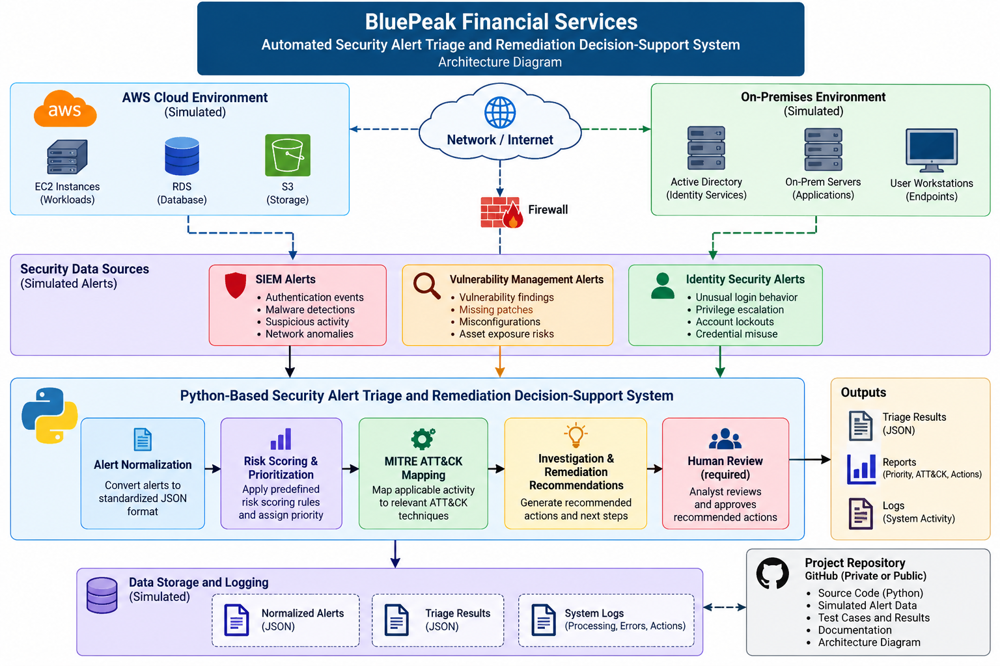

# BluePeak Security Alert Triage Capstone

**Project:** Automated Security Alert Triage and Remediation Decision-Support System  
**Environment:** BluePeak Financial Services (fictitious; simulated data only)

This WGU capstone lab implements a Python-based workflow that ingests simulated SIEM, vulnerability-management, and identity-security alerts, normalizes them to a common JSON schema, applies predefined risk scoring and prioritization, maps applicable activity to MITRE ATT&CK, generates investigation/remediation decision-support recommendations, and requires human analyst review before remediation.



## Scope
- Simulated data only; no production or proprietary organizational data.
- Decision support only; no automatic remediation.
- Deterministic rules are used so expected and actual results can be compared reproducibly.

## Run
```bash
python -m src.main
python -m unittest discover -s tests -v
```

## Evidence
- `data/` — controlled simulated inputs and expected outcomes
- `output/triage_results.json` — actual end-to-end results
- `output/evaluation_results.json` — KPI and acceptance-criteria evaluation
- `evidence/test_results.txt` — automated unit/integration test transcript
- `docs/bluepeak_architecture.png` — architecture artifact

## Evidence Preservation

`evidence/baseline/` preserves pre-refinement evidence. `evidence/final/` contains the final summative run after ATT&CK scenario clarification, measured KPI calculations, and safe invalid-input handling were added. `evidence/refinement_log.md` documents the changes between the two states.
